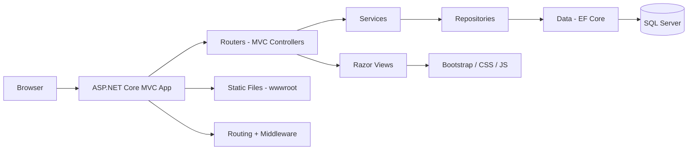

# VozUniversitaria

VozUniversitaria is a web application developed with ASP.NET Core MVC on .NET 8. The project follows a clean MVC structure and uses the default ASP.NET Core web template with Razor views, Bootstrap styling, and modern server-side rendering practices.

## Overview

VozUniversitaria is a university communication and academic information portal. The
current implementation provides an ASP.NET Core MVC application with user registration,
cookie-based login, role-based authorization, and SQL Server persistence through Entity
Framework Core.

## Tech Stack

- .NET 8
- ASP.NET Core MVC
- C#
- Razor Views
- HTML5
- CSS3
- JavaScript
- Bootstrap
- Entity Framework Core 8
- SQL Server
- BCrypt.Net-Next
- Git / GitFlow
- Visual Studio Code dev container

## Features

- ASP.NET Core MVC architecture
- Razor-based view rendering
- Bootstrap-powered responsive layout
- Static assets served from `wwwroot`
- Home and privacy pages
- User registration and login
- ASP.NET Core Identity authentication using application cookies
- Role-based authorization with Identity roles
- Public registration is limited to Student, Teacher, and Staff; Admin is not selectable or accepted from a forged request
- User validation with ViewModels and DataAnnotations
- Identity password hashing, with transparent BCrypt hash migration on the user's next successful login
- Institutional email verification using one-time codes (OTP)
- SQL Server persistence and EF Core migrations

## Project Structure

```text
VozUniversitaria/
├── Routers/
│   ├── AccountController.cs
│   └── HomeController.cs
├── Data/
│   ├── AppDbContext.cs
│   └── AppDbContextFactory.cs
├── Repositories/
│   ├── IOtpRepository.cs
│   └── OtpRepository.cs
├── Migrations/
│   ├── EF Core migration files
│   └── AppDbContextModelSnapshot.cs
├── Models/
│   ├── ErrorViewModel.cs
│   ├── StudentProfile.cs
│   └── Users.cs
├── Services/
│   ├── IEmailSender.cs
│   ├── LegacyBcryptPasswordHasher.cs
│   ├── OtpService.cs
│   ├── SmtpEmailSender.cs
│   └── UsersClaimsPrincipalFactory.cs
├── ViewModels/
│   ├── LoginViewModel.cs
│   ├── RegisterViewModel.cs
│   └── VerifyEmailViewModel.cs
├── Views/
│   ├── Home/
│   │   ├── Index.cshtml
│   │   └── Privacy.cshtml
│   ├── Shared/
│   │   ├── _Layout.cshtml
│   │   └── _Layout.cshtml.css
│   ├── _ViewImports.cshtml
│   └── _ViewStart.cshtml
├── wwwroot/
│   ├── css/
│   └── lib/
├── Program.cs
├── appsettings.json
├── appsettings.Development.json
├── VozUniversitaria.csproj
└── Properties/
    └── launchSettings.json
```

## Architecture Diagram



## Getting Started

### Prerequisites

- .NET 8 SDK
- SQL Server available at `localhost:1433` with credentials matching the connection string in `VozUniversitaria/appsettings.json`
- A code editor such as Visual Studio Code
- Git

### Installation

1. Clone the repository:

```bash
git clone <repository-url>
cd VozUniversitaria
```

2. Restore the repository's local .NET tools and NuGet packages:

```bash
dotnet tool restore
dotnet restore
```

3. Create or update the local database by applying the EF Core migrations:

```bash
dotnet ef database update --project VozUniversitaria/VozUniversitaria.csproj
```

4. Build the application:

```bash
dotnet build
```

5. Run the application:

```bash
dotnet run --project VozUniversitaria/VozUniversitaria.csproj
```

6. Open the browser to the local URL shown in the terminal, usually:

```text
https://localhost:5001
```

If the app is running in development mode, the local port may vary depending on your machine configuration.

## Configuration

The project includes the default ASP.NET Core configuration files:

- `appsettings.json` — application settings
- `appsettings.Development.json` — development-specific settings
- `Properties/launchSettings.json` — local launch profiles

SMTP credentials must not be committed to configuration files. Configure them with
ASP.NET Core User Secrets for local development:

```bash
dotnet user-secrets set "Smtp:User" "your-email@example.com" --project VozUniversitaria/VozUniversitaria.csproj
dotnet user-secrets set "Smtp:Password" "your-smtp-app-password" --project VozUniversitaria/VozUniversitaria.csproj
dotnet user-secrets set "Smtp:From" "your-email@example.com" --project VozUniversitaria/VozUniversitaria.csproj
```

Use credentials provided by your email provider. For deployed environments, configure all
required `Smtp:*` settings through environment variables or a secret manager instead of
User Secrets.

## Database and Entity Framework Core

The application uses SQL Server through Entity Framework Core. The connection string is
configured as `ConnectionStrings:DefaultConnection` in
`VozUniversitaria/appsettings.json` and points to the local development database
`VozUniversitariaDb` on `localhost:1433`.

The current data model contains the `Users` entity, which extends `IdentityUser<int>` and
retains the application's profile, role, and OTP verification fields. ASP.NET Core Identity
stores authentication and role data in `Users` and the `AspNetRoles`, `AspNetUserRoles`,
`AspNetUserClaims`, `AspNetRoleClaims`, `AspNetUserLogins`, and `AspNetUserTokens` tables.
The application roles are:

- `Student`
- `Teacher`
- `Admin`
- `Staff`

The Identity migration preserves the existing `Users` table and its rows, backfills Identity
user names and normalized email values, and copies the existing OTP verification status to
Identity's `EmailConfirmed` field. Existing BCrypt password hashes remain valid and are
rehashed with the Identity password hasher after a successful login. New registrations use
the Identity password hasher directly. OTP email verification remains part of the
registration and sign-in flow. If the database contains the older string-keyed Identity
tables, the migration copies them to `LegacyAspNet*` archive tables, rebuilds the active
Identity tables with integer keys, imports legacy accounts whose email is not already in
`Users`, and maps their roles and Identity data to the matching account. When an email
already exists in `Users`, that existing user remains the active account and the full
legacy row remains archived.

### Apply migrations

From the repository root, restore the local EF Core tool once, then apply migrations:

```bash
dotnet tool restore
dotnet ef database update --project VozUniversitaria/VozUniversitaria.csproj
```

To list the available migrations:

```bash
dotnet ef migrations list --project VozUniversitaria/VozUniversitaria.csproj
```

The project currently includes the following migrations:

1. `20260908045623_InitialCreate`
2. `20260930020433_AddEmailVerification`
3. `20261002063924_AddIdentityCore`
4. `20261016025735_AddStudentProfile`

### Local SQL Server connection

When using the development container, configure a SQL Server instance at `localhost:1433`
and make sure the credentials match the connection string in `appsettings.json`. The
development password must not be reused in production.

To connect from VS Code (using the **SQL Server (mssql)** extension):

1. Open the SQL Server panel in the sidebar (database icon).
2. Create a new connection with the following details:
   - **Server name:** `localhost`
   - **Port:** `1433`
   - **Trust server certificate:** enabled (the container uses a self-signed certificate)
   - **Authentication type:** SQL Login
   - **User name:** `sa`
    - **Password:** use the password configured in `appsettings.json`
    - **Database name:** `VozUniversitariaDb`
3. Click "Connect".

## Development Notes

The current implementation focuses on authentication and the initial user data model.
The student profile schema exists, but profile management flows and the following
features are not implemented yet:

- teacher profiles
- courses and enrollments
- announcements and internal messages
- content management CRUD
- API layer
- external service integrations
- admin dashboard

The planned data model and future entities are documented in `architecture.md`.

## Contribution Guidelines

Contributions are welcome. To keep the project consistent and maintainable, please follow these guidelines:

1. Create a feature branch before making changes:

```bash
git checkout -b feature/your-feature-name
```

2. Keep changes focused and aligned with the project purpose.

3. Follow C# and ASP.NET Core coding conventions.

4. Add or update documentation when behavior or setup changes.

5. Validate the project before submitting a pull request:

```bash
dotnet build
```

6. Submit a pull request with a clear description of the change and its purpose.

## License

This project does not currently specify a license file. If you plan to share or distribute it publicly, consider adding an appropriate open-source license such as MIT or Apache 2.0.

## Maintainers

This project is currently in an early development stage and is best suited for continued extension by the project owner or development team.
## Backend framework

ASP.NET Core 8 (MVC). How to start it, project layout and request handling:
see [docs/backend-framework.md](docs/backend-framework.md).
