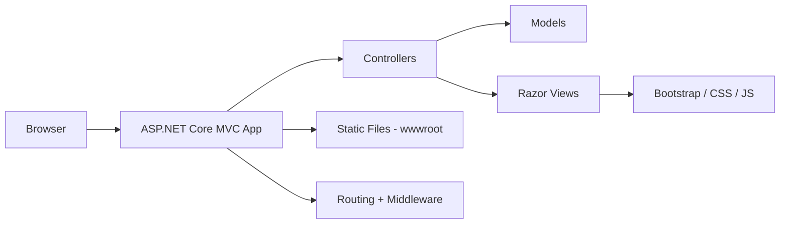

# VozUniversitaria

VozUniversitaria is a web application developed with ASP.NET Core MVC on .NET 8. The project follows a clean MVC structure and uses the default ASP.NET Core web template with Razor views, Bootstrap styling, and modern server-side rendering practices.

## Overview

This project is intended as a foundation for a university-related communication or information portal. It currently provides a simple MVC structure and ready-to-extend pages for future feature development, such as user authentication, academic information, announcements, and administrative tools.

## Tech Stack

- .NET 8
- ASP.NET Core MVC
- C#
- Razor Views
- HTML5
- CSS3
- JavaScript
- Bootstrap
- jQuery
- Git / GitFlow
- Visual Studio Code dev container

## Features

- ASP.NET Core MVC architecture
- Razor-based view rendering
- Bootstrap-powered responsive layout
- Static assets served from `wwwroot`
- Default home and privacy pages
- MVC routing configuration out of the box
- Easy extension for future business-domain features

## Project Structure

```text
VozUniversitaria/
├── Controllers/
│   └── HomeController.cs
├── Models/
│   └── ErrorViewModel.cs
├── Views/
│   ├── Home/
│   │   ├── Index.cshtml
│   │   └── Privacy.cshtml
│   ├── Shared/
│   │   ├── _Layout.cshtml
│   │   ├── _Layout.cshtml.css
│   │   └── _ValidationScriptsPartial.cshtml
│   ├── _ViewImports.cshtml
│   └── _ViewStart.cshtml
├── wwwroot/
│   ├── css/
│   ├── js/
│   └── lib/
├── Program.cs
├── appsettings.json
├── appsettings.Development.json
├── VozUniversitaria.csproj
└── Properties/
    └── launchSettings.json
```

## Architecture Diagram



## Getting Started

### Prerequisites

- .NET 8 SDK
- A code editor such as Visual Studio Code
- Git

### Installation

1. Clone the repository:

```bash
git clone <repository-url>
cd VozUniversitaria-master
```

2. Restore packages:

```bash
dotnet restore
```

3. Build the application:

```bash
dotnet build
```

4. Run the application:

```bash
dotnet run --project VozUniversitaria/VozUniversitaria.csproj
```

5. Open the browser to the local URL shown in the terminal, usually:

```text
https://localhost:5001
```

If the app is running in development mode, the local port may vary depending on your machine configuration.

## Configuration

The project includes the default ASP.NET Core configuration files:

- `appsettings.json` — application settings
- `appsettings.Development.json` — development-specific settings
- `Properties/launchSettings.json` — local launch profiles

<<<<<<< HEAD
=======
## Database Connection (SQL Server)

This project includes a SQL Server 2019 container defined in `.devcontainer/docker-compose.yml`, which starts automatically when the project is opened in a Dev Container.

To connect from VS Code (using the **SQL Server (mssql)** extension):

1. Open the SQL Server panel in the sidebar (database icon).
2. Create a new connection with the following details:
   - **Server name:** `localhost`
   - **Port:** `1433`
   - **Trust server certificate:** enabled (the container uses a self-signed certificate)
   - **Authentication type:** SQL Login
   - **User name:** `sa`
   - **Password:** `P@ssw0rd` (defined in `SA_PASSWORD` inside `docker-compose.yml`)
   - **Database name:** `master` (the project doesn't have its own database yet)
3. Click "Connect".

<!-- Note: these credentials are for the local development (dev container) environment only, and are already visible in `docker-compose.yml`. They pose no security risk for production. -->

>>>>>>> 7fbdbca6676f3b14a793f8e28dbfe70cfc8f477e
## Development Notes

The current implementation is intentionally lightweight and follows the standard ASP.NET Core template. It does not yet include:

- database integration
- authentication/authorization
- API layer
- external service integrations
- admin dashboard or business rules implementation

This makes it an ideal base for future development and feature expansion.

## Contribution Guidelines

Contributions are welcome. To keep the project consistent and maintainable, please follow these guidelines:

1. Create a feature branch before making changes:

```bash
git checkout -b feature/your-feature-name
```

2. Keep changes focused and aligned with the project purpose.

3. Follow C# and ASP.NET Core coding conventions.

4. Add or update documentation when behavior or setup changes.

5. Validate the project before submitting a pull request:

```bash
dotnet build
```

6. Submit a pull request with a clear description of the change and its purpose.

## License

This project does not currently specify a license file. If you plan to share or distribute it publicly, consider adding an appropriate open-source license such as MIT or Apache 2.0.

## Maintainers

This project is currently in an early development stage and is best suited for continued extension by the project owner or development team.
<<<<<<< HEAD
=======


>>>>>>> 7fbdbca6676f3b14a793f8e28dbfe70cfc8f477e
