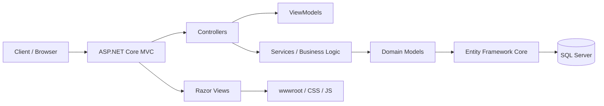
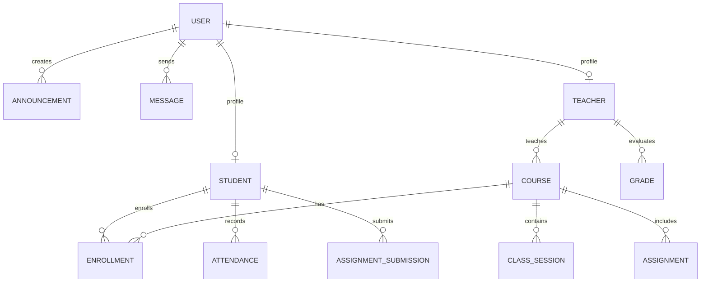

# Architecture and Data Model - VozUniversitaria

## 1. Overview

VozUniversitaria is a web application built with ASP.NET Core MVC on .NET 8, focused on a university communication and academic management portal. The current solution is structured in MVC layers and already defines an initial user model in `VozUniversitaria/Models/Users.cs` and an EF Core context in `VozUniversitaria/Data/AppDbContext.cs`.

The proposed architecture should follow a clear separation between:

- Presentation: controllers, Razor views, Bootstrap, JavaScript
- Domain: entities and business rules
- Persistence: DbContext, Entity Framework Core, migrations
- Security: authentication, authorization, and session management

---

## 2. Proposed architecture



### 2.1 Presentation layer

Responsible for:

- handling HTTP requests
- validating form inputs
- returning Razor views
- exposing endpoints for authentication and navigation

Examples in the current project:

- `Controllers/AccountController.cs`
- `Controllers/HomeController.cs`
- `Views/Account/*.cshtml`
- `Views/Home/*.cshtml`

### 2.2 Domain layer

Responsible for:

- defining business entities and relationships
- encapsulating important business rules
- maintaining consistency between users, students, teachers, and administration

### 2.3 Persistence layer

Responsible for:

- mapping entities to SQL tables
- managing migrations
- executing queries and relationships with EF Core

Current state:

- `AppDbContext` exposes `DbSet<Users>`
- the base is ready to grow with more entities and relationships

---

## 3. Current data model

The current base includes a central entity called `Users`, which represents a general system user.

### 3.1 `Users` entity

```csharp
public class Users
{
    public int Id { get; set; }
    public required string Name { get; set; }
    public required string LastName { get; set; }
    public required string CaseNumber { get; set; }
    public required string Email { get; set; }
    public required string PasswordHash { get; set; }
    public UserRole Role { get; set; }
    public bool IsActive { get; set; } = true;
    public DateTime CreatedAt { get; set; } = DateTime.UtcNow;
}

public enum UserRole
{
    Student,
    Teacher,
    Admin,
    Staff
}
```

### 3.2 Property descriptions

- `Id`: unique user identifier
- `Name`: first name
- `LastName`: last name
- `CaseNumber`: enrollment number or institutional document number
- `Email`: institutional or personal email
- `PasswordHash`: encrypted password using secure hashing
- `Role`: user role within the system
- `IsActive`: user status (active/inactive)
- `CreatedAt`: record creation date

### 3.3 Current roles

| Role | Description |
| --- | --- |
| Student | University student |
| Teacher | Teacher or professor |
| Admin | System administrator |
| Staff | Administrative staff |

---

## 4. Recommended data model for the university

The project needs to grow from a base user model toward a more complete academic model. The following structure is a healthy proposal for a university portal.

### 4.1 Main entities



### 4.2 `User` entity

```csharp
public class User
{
    public int Id { get; set; }
    public string Name { get; set; } = string.Empty;
    public string LastName { get; set; } = string.Empty;
    public string Email { get; set; } = string.Empty;
    public string PasswordHash { get; set; } = string.Empty;
    public UserRole Role { get; set; }
    public bool IsActive { get; set; } = true;
    public DateTime CreatedAt { get; set; } = DateTime.UtcNow;
    public DateTime? UpdatedAt { get; set; }
}
```

### 4.3 `Student` entity

```csharp
public class Student
{
    public int Id { get; set; }
    public int UserId { get; set; }
    public string StudentCode { get; set; } = string.Empty;
    public string Career { get; set; } = string.Empty;
    public int Semester { get; set; }
    public bool IsGraduated { get; set; }
    public DateTime CreatedAt { get; set; } = DateTime.UtcNow;

    public User? User { get; set; }
    public ICollection<Enrollment>? Enrollments { get; set; }
}
```

### 4.4 `Teacher` entity

```csharp
public class Teacher
{
    public int Id { get; set; }
    public int UserId { get; set; }
    public string EmployeeCode { get; set; } = string.Empty;
    public string Department { get; set; } = string.Empty;
    public string Title { get; set; } = string.Empty;
    public DateTime CreatedAt { get; set; } = DateTime.UtcNow;

    public User? User { get; set; }
    public ICollection<Course>? Courses { get; set; }
}
```

### 4.5 `Course` entity

```csharp
public class Course
{
    public int Id { get; set; }
    public string Code { get; set; } = string.Empty;
    public string Name { get; set; } = string.Empty;
    public string Description { get; set; } = string.Empty;
    public int Credits { get; set; }
    public int TeacherId { get; set; }
    public int Semester { get; set; }
    public bool IsActive { get; set; } = true;

    public Teacher? Teacher { get; set; }
    public ICollection<Enrollment>? Enrollments { get; set; }
    public ICollection<Assignment>? Assignments { get; set; }
}
```

### 4.6 `Enrollment` entity

```csharp
public class Enrollment
{
    public int Id { get; set; }
    public int StudentId { get; set; }
    public int CourseId { get; set; }
    public DateTime EnrolledAt { get; set; } = DateTime.UtcNow;
    public string Status { get; set; } = "Active";

    public Student? Student { get; set; }
    public Course? Course { get; set; }
}
```

### 4.7 `Announcement` entity

```csharp
public class Announcement
{
    public int Id { get; set; }
    public int AuthorUserId { get; set; }
    public string Title { get; set; } = string.Empty;
    public string Content { get; set; } = string.Empty;
    public DateTime CreatedAt { get; set; } = DateTime.UtcNow;
    public bool IsPublished { get; set; } = true;

    public User? Author { get; set; }
}
```

### 4.8 `Message` entity

```csharp
public class Message
{
    public int Id { get; set; }
    public int SenderUserId { get; set; }
    public int ReceiverUserId { get; set; }
    public string Subject { get; set; } = string.Empty;
    public string Content { get; set; } = string.Empty;
    public DateTime SentAt { get; set; } = DateTime.UtcNow;
    public bool IsRead { get; set; }

    public User? Sender { get; set; }
    public User? Receiver { get; set; }
}
```

---

## 5. Key relationships

1. `User` is the base entity of the system.
2. `Student` and `Teacher` extend the user's identity with academic profiles.
3. A `Student` can be enrolled in many `Course` records through `Enrollment`.
4. A `Teacher` can teach several `Course` records.
5. `Announcement` represents institutional communications.
6. `Message` represents internal communication between users.

---

## 6. Suggested business rules

- Each user must have a unique email.
- A student must have a unique enrollment code.
- A teacher must have a unique employee code.
- A course must not be duplicated by code and name.
- A registration cannot be repeated for the same student and course.
- Communications must include author, date, and publication status.
- Passwords must be stored only as hashed values, never in plain text.

---

## 7. Persistence conventions

To keep the solution organized and scalable, it is recommended to:

- use `DbContext` as the central data access point
- name entities in singular form (`User`, `Course`, `Student`)
- use auto-increment primary keys (`int` or `Guid` depending on need)
- use `DateTime.UtcNow` for global dates
- apply indexes to unique fields such as `Email`, `StudentCode`, `EmployeeCode`
- add `CreatedAt` and `UpdatedAt` columns where applicable
- create migrations for each significant schema change

---

## 8. Project evolution recommendation

The current project has a solid base to start from, but it should evolve in this sequence:

1. Register and authenticate users
2. Separate `Student` and `Teacher` profiles
3. Create courses and subjects
4. Implement enrollments and grades
5. Add announcements and internal messages
6. Expose APIs or services for a modern frontend
7. Add advanced roles and permissions

---

## 9. Current repository state vs. ideal model

| Aspect | Current state | Goal |
| --- | --- | --- |
| Base user | Yes | Yes |
| Real authentication | No | Yes |
| Student profile | No | Yes |
| Teacher profile | No | Yes |
| Courses | No | Yes |
| Enrollments | No | Yes |
| Announcements | No | Yes |
| Messaging | No | Yes |
| EF Core with multiple entities | Partial | Complete |

---

## 10. Conclusion

The current `Users` model is an excellent starting point for a university system. However, to align with VozUniversitaria's goal, it should evolve into a model with users, academic profiles, courses, enrollments, announcements, and messages. This structure will provide greater scalability, maintainability, and alignment with university operations.

## 11. SQL Server and EF Core-oriented variant

For a real SQL Server deployment, the solution should maintain a more explicit business structure. The idea is that each entity has its own table and relationships defined with foreign keys.

### 11.1 Suggested table model

```sql
CREATE TABLE Users (
    Id INT IDENTITY(1,1) PRIMARY KEY,
    Name NVARCHAR(120) NOT NULL,
    LastName NVARCHAR(120) NOT NULL,
    Email NVARCHAR(255) NOT NULL UNIQUE,
    PasswordHash NVARCHAR(255) NOT NULL,
    Role INT NOT NULL DEFAULT 0,
    IsActive BIT NOT NULL DEFAULT 1,
    CreatedAt DATETIME2 NOT NULL DEFAULT SYSUTCDATETIME(),
    UpdatedAt DATETIME2 NULL
);

CREATE TABLE Students (
    Id INT IDENTITY(1,1) PRIMARY KEY,
    UserId INT NOT NULL UNIQUE,
    StudentCode NVARCHAR(50) NOT NULL UNIQUE,
    Career NVARCHAR(150) NOT NULL,
    Semester INT NOT NULL,
    IsGraduated BIT NOT NULL DEFAULT 0,
    CreatedAt DATETIME2 NOT NULL DEFAULT SYSUTCDATETIME(),
    CONSTRAINT FK_Students_Users FOREIGN KEY (UserId) REFERENCES Users(Id)
);

CREATE TABLE Teachers (
    Id INT IDENTITY(1,1) PRIMARY KEY,
    UserId INT NOT NULL UNIQUE,
    EmployeeCode NVARCHAR(50) NOT NULL UNIQUE,
    Department NVARCHAR(150) NOT NULL,
    Title NVARCHAR(150) NOT NULL,
    CreatedAt DATETIME2 NOT NULL DEFAULT SYSUTCDATETIME(),
    CONSTRAINT FK_Teachers_Users FOREIGN KEY (UserId) REFERENCES Users(Id)
);

CREATE TABLE Courses (
    Id INT IDENTITY(1,1) PRIMARY KEY,
    Code NVARCHAR(50) NOT NULL UNIQUE,
    Name NVARCHAR(200) NOT NULL,
    Description NVARCHAR(MAX) NULL,
    Credits INT NOT NULL,
    TeacherId INT NOT NULL,
    Semester INT NOT NULL,
    IsActive BIT NOT NULL DEFAULT 1,
    CONSTRAINT FK_Courses_Teachers FOREIGN KEY (TeacherId) REFERENCES Teachers(Id)
);

CREATE TABLE Enrollments (
    Id INT IDENTITY(1,1) PRIMARY KEY,
    StudentId INT NOT NULL,
    CourseId INT NOT NULL,
    EnrolledAt DATETIME2 NOT NULL DEFAULT SYSUTCDATETIME(),
    Status NVARCHAR(50) NOT NULL DEFAULT 'Active',
    CONSTRAINT FK_Enrollments_Students FOREIGN KEY (StudentId) REFERENCES Students(Id),
    CONSTRAINT FK_Enrollments_Courses FOREIGN KEY (CourseId) REFERENCES Courses(Id),
    CONSTRAINT UQ_Enrollment UNIQUE (StudentId, CourseId)
);

CREATE TABLE Announcements (
    Id INT IDENTITY(1,1) PRIMARY KEY,
    AuthorUserId INT NOT NULL,
    Title NVARCHAR(200) NOT NULL,
    Content NVARCHAR(MAX) NOT NULL,
    CreatedAt DATETIME2 NOT NULL DEFAULT SYSUTCDATETIME(),
    IsPublished BIT NOT NULL DEFAULT 1,
    CONSTRAINT FK_Announcements_Users FOREIGN KEY (AuthorUserId) REFERENCES Users(Id)
);

CREATE TABLE Messages (
    Id INT IDENTITY(1,1) PRIMARY KEY,
    SenderUserId INT NOT NULL,
    ReceiverUserId INT NOT NULL,
    Subject NVARCHAR(200) NULL,
    Content NVARCHAR(MAX) NOT NULL,
    SentAt DATETIME2 NOT NULL DEFAULT SYSUTCDATETIME(),
    IsRead BIT NOT NULL DEFAULT 0,
    CONSTRAINT FK_Messages_Sender FOREIGN KEY (SenderUserId) REFERENCES Users(Id),
    CONSTRAINT FK_Messages_Receiver FOREIGN KEY (ReceiverUserId) REFERENCES Users(Id)
);
```

### 11.2 Recommended EF Core structure

```csharp
public class AppDbContext : DbContext
{
    public DbSet<User> Users { get; set; }
    public DbSet<Student> Students { get; set; }
    public DbSet<Teacher> Teachers { get; set; }
    public DbSet<Course> Courses { get; set; }
    public DbSet<Enrollment> Enrollments { get; set; }
    public DbSet<Announcement> Announcements { get; set; }
    public DbSet<Message> Messages { get; set; }

    protected override void OnModelCreating(ModelBuilder modelBuilder)
    {
        modelBuilder.Entity<User>()
            .HasIndex(u => u.Email)
            .IsUnique();

        modelBuilder.Entity<Student>()
            .HasIndex(s => s.StudentCode)
            .IsUnique();

        modelBuilder.Entity<Teacher>()
            .HasIndex(t => t.EmployeeCode)
            .IsUnique();

        modelBuilder.Entity<Course>()
            .HasIndex(c => c.Code)
            .IsUnique();

        modelBuilder.Entity<Enrollment>()
            .HasIndex(e => new { e.StudentId, e.CourseId })
            .IsUnique();
    }
}
```

### 11.3 Production considerations

- use `PasswordHash` and do not store passwords in plain text
- keep `CreatedAt` / `UpdatedAt` in UTC
- add indexes for frequent searches: email, student code, teacher code, course name
- separate domain from infrastructure to ease testing and maintenance
- use migrations with `dotnet ef migrations add ...` and `dotnet ef database update`

### 11.4 Incremental implementation recommendation

1. `Users` as the current base
2. `Students` and `Teachers` as extended profiles
3. `Courses` and `Enrollments`
4. `Announcements` and `Messages`
5. business services for authentication, enrollment, and administration

This allows growth without breaking the main system structure.

If desired, the next step could be:

- create the complete model in C# with classes such as `User`, `Student`, `Course`, etc.
- generate the final `DbContext` structure
- prepare the initial migrations for SQL Server
- provide an ER diagram proposal ready for documentation
