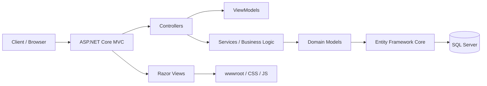
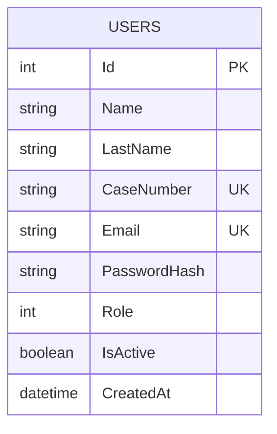
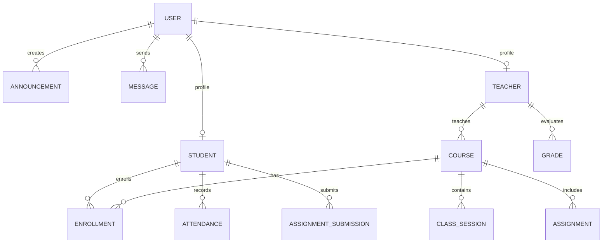

## 1. Overview

See `PROPOSAL.md` §1 for the full project overview. Per `README.md`, the implementation
currently includes: the ASP.NET Core MVC skeleton, user registration and cookie-based login
(`AccountController`), role-based authorization (`Student`/`Teacher`/`Admin`/`Staff` claims
and policies), and SQL Server persistence via EF Core (`AppDbContext`, 3 migrations, seed
data). Content-domain features — courses, enrollments, announcements, messaging, CMS CRUD —
are not yet implemented; see §4.2 "Planned evolution."

---

## 2. Proposed architecture

The diagram below is the target internal structure (adds the ViewModel/Service split on top
of `README.md`'s higher-level diagram):



### 2.1 Presentation layer

**Currently implemented** (per `README.md` → Project Structure):

- `Controllers/HomeController.cs`
- `Controllers/AccountController.cs`
- `ViewModels/LoginViewModel.cs`, `ViewModels/RegisterViewModel.cs` (input validation with
  DataAnnotations)
- `Views/Home/*.cshtml`, `Views/Shared/*.cshtml`

> `README.md`'s Project Structure tree doesn't list a `Views/Account/` folder, even
> though registration/login are described as implemented. Confirm the actual view path
> before referencing it elsewhere.

**Planned, not yet implemented:**

- Controllers for courses, announcements, internal messaging, admin dashboard, CMS CRUD

### 2.2 Domain layer

**Currently implemented:** the `Users` entity (§4.1) with a `UserRole` enum (`Student`,
`Teacher`, `Admin`, `Staff`), unique `Email` and `CaseNumber` constraints, and BCrypt
password hashing.

**Planned:** `Student`, `Teacher`, `Course`, `Enrollment`, `Announcement`, `Message`
entities (§4.2).

### 2.3 Persistence layer

**Currently implemented:** `AppDbContext` and `AppDbContextFactory` (`Data/`), 3 EF Core
migrations (`InitialCreate`, `AddUserConstraintsAndSeeding`, `FixSeedUserPasswordHash`),
SQL Server connection via `ConnectionStrings:DefaultConnection` → `VozUniversitariaDb`.
Full migration commands are documented in `README.md` → "Database and Entity Framework
Core" — not repeated here.

---

## 3. Project evolution recommendation

1. Register and authenticate users — done
2. Separate `Student` and `Teacher` profiles
3. Create courses and subjects
4. Implement enrollments and grades
5. Add announcements and internal messages
6. Expose APIs or services for a modern frontend
7. Add advanced roles and permissions

> For the phase/status-level roadmap, see `PROPOSAL.md` §5.

---

## 4. Data model

### 4.1 Current implemented entity: `Users`

> Verify the fields below against the current `Models/Users.cs` and the applied
> migrations — this reflects the previously documented shape plus `README.md`'s confirmed
> constraints (unique `Email`/`CaseNumber`, BCrypt hash, `Role`).

```csharp
public class Users
{
    public int Id { get; set; }
    public required string Name { get; set; }
    public required string LastName { get; set; }
    public required string CaseNumber { get; set; }
    public required string Email { get; set; }
    public required string PasswordHash { get; set; }
    public UserRole Role { get; set; }
    public bool IsActive { get; set; } = true;
    public DateTime CreatedAt { get; set; } = DateTime.UtcNow;
}

public enum UserRole
{
    Student,
    Teacher,
    Admin,
    Staff
}
```



Applied via migration `InitialCreate` (plus `AddUserConstraintsAndSeeding` for the unique
indexes and seed data, and `FixSeedUserPasswordHash`).

### 4.2 Planned evolution

Each entity below must be added to the C# model and `AppDbContext`, followed by a new EF
Core migration containing its foreign keys and indexes.



```csharp
public class Student
{
    public int Id { get; set; }
    public int UserId { get; set; }
    public string StudentCode { get; set; } = string.Empty;
    public string Career { get; set; } = string.Empty;
    public int Semester { get; set; }
    public bool IsGraduated { get; set; }
    public DateTime CreatedAt { get; set; } = DateTime.UtcNow;

    public Users? User { get; set; }
    public ICollection<Enrollment>? Enrollments { get; set; }
}

public class Teacher
{
    public int Id { get; set; }
    public int UserId { get; set; }
    public string EmployeeCode { get; set; } = string.Empty;
    public string Department { get; set; } = string.Empty;
    public string Title { get; set; } = string.Empty;
    public DateTime CreatedAt { get; set; } = DateTime.UtcNow;

    public Users? User { get; set; }
    public ICollection<Course>? Courses { get; set; }
}

public class Course
{
    public int Id { get; set; }
    public string Code { get; set; } = string.Empty;
    public string Name { get; set; } = string.Empty;
    public string Description { get; set; } = string.Empty;
    public int Credits { get; set; }
    public int TeacherId { get; set; }
    public int Semester { get; set; }
    public bool IsActive { get; set; } = true;

    public Teacher? Teacher { get; set; }
    public ICollection<Enrollment>? Enrollments { get; set; }
    public ICollection<Assignment>? Assignments { get; set; }
}

public class Enrollment
{
    public int Id { get; set; }
    public int StudentId { get; set; }
    public int CourseId { get; set; }
    public DateTime EnrolledAt { get; set; } = DateTime.UtcNow;
    public string Status { get; set; } = "Active";

    public Student? Student { get; set; }
    public Course? Course { get; set; }
}

public class Announcement
{
    public int Id { get; set; }
    public int AuthorUserId { get; set; }
    public string Title { get; set; } = string.Empty;
    public string Content { get; set; } = string.Empty;
    public DateTime CreatedAt { get; set; } = DateTime.UtcNow;
    public bool IsPublished { get; set; } = true;

    public Users? Author { get; set; }
}

public class Message
{
    public int Id { get; set; }
    public int SenderUserId { get; set; }
    public int ReceiverUserId { get; set; }
    public string Subject { get; set; } = string.Empty;
    public string Content { get; set; } = string.Empty;
    public DateTime SentAt { get; set; } = DateTime.UtcNow;
    public bool IsRead { get; set; }

    public Users? Sender { get; set; }
    public Users? Receiver { get; set; }
}
```

### 4.3 Key relationships

1. `Users` is the base entity of the system (implemented).
2. `Student` and `Teacher` extend the user's identity with academic profiles (planned).
3. A `Student` can be enrolled in many `Course` records through `Enrollment` (planned).
4. A `Teacher` can teach several `Course` records (planned).
5. `Announcement` represents institutional communications (planned).
6. `Message` represents internal communication between users (planned).

### 4.4 Data business rules

**Implemented (per `README.md`):**

- Each user has a unique email.
- Each user has a unique `CaseNumber`.
- Passwords are stored only as BCrypt hashes, never in plain text.
- Inactive users must not be authenticated.
- All persisted dates use UTC (`DateTime.UtcNow`).

**Planned (for entities not yet built):**

- A student must have a unique enrollment code (`StudentCode`).
- A teacher must have a unique employee code.
- A course must not be duplicated by code and name.
- A registration cannot be repeated for the same student and course.
- Communications must include author, date, and publication status.

### 4.5 Persistence conventions

- use `DbContext` as the central data access point
- name entities in singular form for new tables (`Course`, `Student` — note the existing
  `Users` entity/table is already plural; keep it as-is to avoid a breaking migration)
- use auto-increment primary keys (`int` or `Guid` depending on need)
- use `DateTime.UtcNow` for global dates
- apply indexes to unique fields such as `Email`, `CaseNumber`, `StudentCode`,
  `EmployeeCode`
- add `CreatedAt` / `UpdatedAt` columns where applicable
- create a migration for each significant schema change

### 4.6 SQL Server / EF Core reference implementation

<details>
<summary><code>Users</code> table — already applied via migrations</summary>

```sql
CREATE TABLE Users (
    Id INT IDENTITY(1,1) PRIMARY KEY,
    Name NVARCHAR(120) NOT NULL,
    LastName NVARCHAR(120) NOT NULL,
    CaseNumber NVARCHAR(50) NOT NULL UNIQUE,
    Email NVARCHAR(255) NOT NULL UNIQUE,
    PasswordHash NVARCHAR(255) NOT NULL,
    Role INT NOT NULL DEFAULT 0,
    IsActive BIT NOT NULL DEFAULT 1,
    CreatedAt DATETIME2 NOT NULL DEFAULT SYSUTCDATETIME()
);
```
</details>

<details>
<summary>Proposed tables for planned entities (not yet migrated)</summary>

```sql
CREATE TABLE Students (
    Id INT IDENTITY(1,1) PRIMARY KEY,
    UserId INT NOT NULL UNIQUE,
    StudentCode NVARCHAR(50) NOT NULL UNIQUE,
    Career NVARCHAR(150) NOT NULL,
    Semester INT NOT NULL,
    IsGraduated BIT NOT NULL DEFAULT 0,
    CreatedAt DATETIME2 NOT NULL DEFAULT SYSUTCDATETIME(),
    CONSTRAINT FK_Students_Users FOREIGN KEY (UserId) REFERENCES Users(Id)
);

CREATE TABLE Teachers (
    Id INT IDENTITY(1,1) PRIMARY KEY,
    UserId INT NOT NULL UNIQUE,
    EmployeeCode NVARCHAR(50) NOT NULL UNIQUE,
    Department NVARCHAR(150) NOT NULL,
    Title NVARCHAR(150) NOT NULL,
    CreatedAt DATETIME2 NOT NULL DEFAULT SYSUTCDATETIME(),
    CONSTRAINT FK_Teachers_Users FOREIGN KEY (UserId) REFERENCES Users(Id)
);

CREATE TABLE Courses (
    Id INT IDENTITY(1,1) PRIMARY KEY,
    Code NVARCHAR(50) NOT NULL UNIQUE,
    Name NVARCHAR(200) NOT NULL,
    Description NVARCHAR(MAX) NULL,
    Credits INT NOT NULL,
    TeacherId INT NOT NULL,
    Semester INT NOT NULL,
    IsActive BIT NOT NULL DEFAULT 1,
    CONSTRAINT FK_Courses_Teachers FOREIGN KEY (TeacherId) REFERENCES Teachers(Id)
);

CREATE TABLE Enrollments (
    Id INT IDENTITY(1,1) PRIMARY KEY,
    StudentId INT NOT NULL,
    CourseId INT NOT NULL,
    EnrolledAt DATETIME2 NOT NULL DEFAULT SYSUTCDATETIME(),
    Status NVARCHAR(50) NOT NULL DEFAULT 'Active',
    CONSTRAINT FK_Enrollments_Students FOREIGN KEY (StudentId) REFERENCES Students(Id),
    CONSTRAINT FK_Enrollments_Courses FOREIGN KEY (CourseId) REFERENCES Courses(Id),
    CONSTRAINT UQ_Enrollment UNIQUE (StudentId, CourseId)
);

CREATE TABLE Announcements (
    Id INT IDENTITY(1,1) PRIMARY KEY,
    AuthorUserId INT NOT NULL,
    Title NVARCHAR(200) NOT NULL,
    Content NVARCHAR(MAX) NOT NULL,
    CreatedAt DATETIME2 NOT NULL DEFAULT SYSUTCDATETIME(),
    IsPublished BIT NOT NULL DEFAULT 1,
    CONSTRAINT FK_Announcements_Users FOREIGN KEY (AuthorUserId) REFERENCES Users(Id)
);

CREATE TABLE Messages (
    Id INT IDENTITY(1,1) PRIMARY KEY,
    SenderUserId INT NOT NULL,
    ReceiverUserId INT NOT NULL,
    Subject NVARCHAR(200) NULL,
    Content NVARCHAR(MAX) NOT NULL,
    SentAt DATETIME2 NOT NULL DEFAULT SYSUTCDATETIME(),
    IsRead BIT NOT NULL DEFAULT 0,
    CONSTRAINT FK_Messages_Sender FOREIGN KEY (SenderUserId) REFERENCES Users(Id),
    CONSTRAINT FK_Messages_Receiver FOREIGN KEY (ReceiverUserId) REFERENCES Users(Id)
);
```
</details>

<details>
<summary>Target <code>AppDbContext</code> (extended)</summary>

```csharp
public class AppDbContext : DbContext
{
    public DbSet<Users> Users { get; set; }
    public DbSet<Student> Students { get; set; }
    public DbSet<Teacher> Teachers { get; set; }
    public DbSet<Course> Courses { get; set; }
    public DbSet<Enrollment> Enrollments { get; set; }
    public DbSet<Announcement> Announcements { get; set; }
    public DbSet<Message> Messages { get; set; }

    protected override void OnModelCreating(ModelBuilder modelBuilder)
    {
        modelBuilder.Entity<Student>()
            .HasIndex(s => s.StudentCode)
            .IsUnique();

        modelBuilder.Entity<Teacher>()
            .HasIndex(t => t.EmployeeCode)
            .IsUnique();

        modelBuilder.Entity<Course>()
            .HasIndex(c => c.Code)
            .IsUnique();

        modelBuilder.Entity<Enrollment>()
            .HasIndex(e => new { e.StudentId, e.CourseId })
            .IsUnique();
    }
}
```
</details>

**Production considerations:**

- add indexes for frequent searches: student code, teacher code, course name (email and
  `CaseNumber` indexes already exist per `README.md`)
- separate domain from infrastructure to ease testing and maintenance
- use `dotnet ef migrations add ...` and `dotnet ef database update` for every schema
  change (full commands in `README.md`)

---

## 5. Current repository state vs. ideal model

| Aspect | Current state (per `README.md`) | Goal |
| --- | --- | --- |
| Base user model | Yes | Yes |
| Real authentication | Yes (cookie-based, role claims) | Yes |
| Student profile | No | Yes |
| Teacher profile | No | Yes |
| Courses | No | Yes |
| Enrollments | No | Yes |
| Announcements | No | Yes |
| Messaging | No | Yes |
| Database / EF Core integration | Yes (3 migrations, seed data) | Yes |

---

## 6. Conclusion

The `Users` model, authentication, and SQL Server persistence are implemented and match
`README.md`. To align with VozUniversitaria's goal, the project still needs academic
profiles, courses, enrollments, announcements, and messages — detailed entity-by-entity in
§4.2 above. This structure will provide greater scalability, maintainability, and alignment
with university operations.