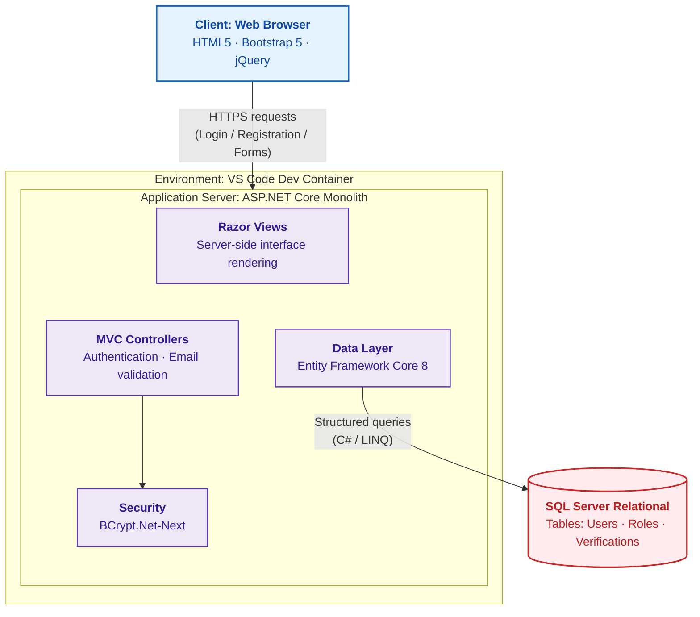
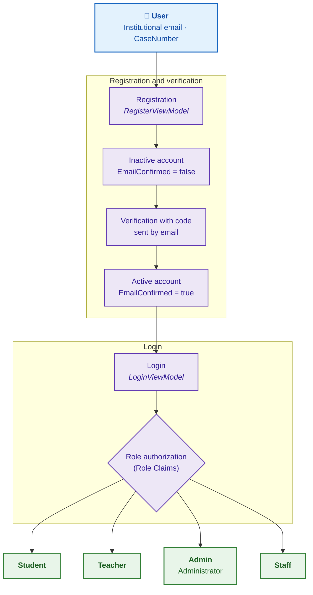
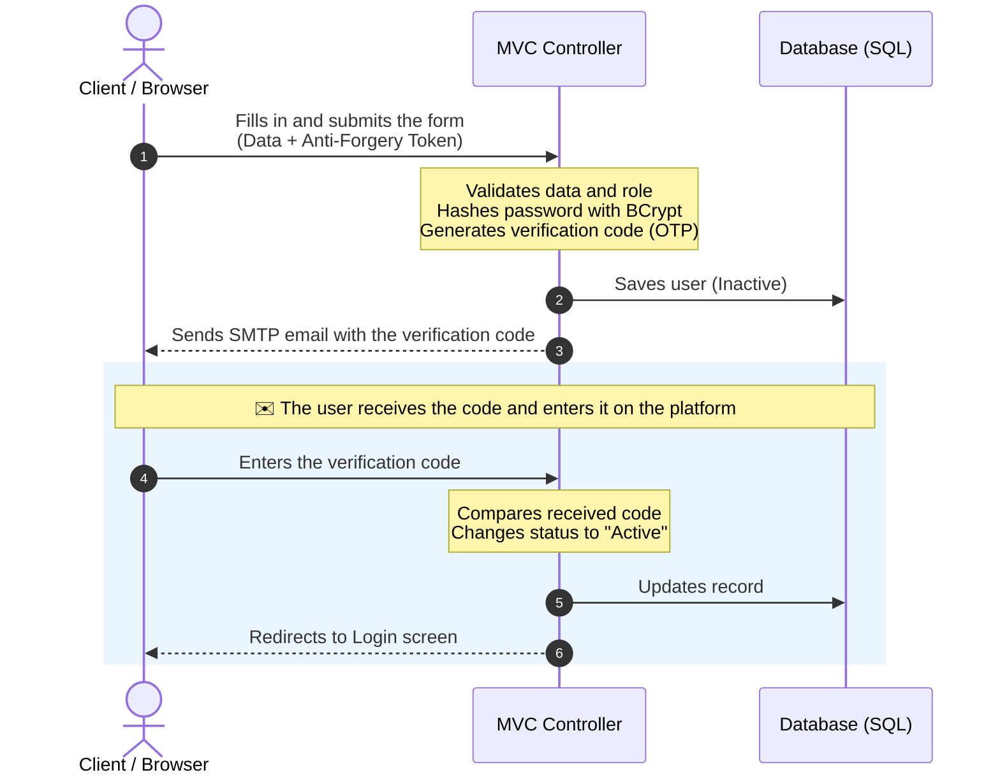
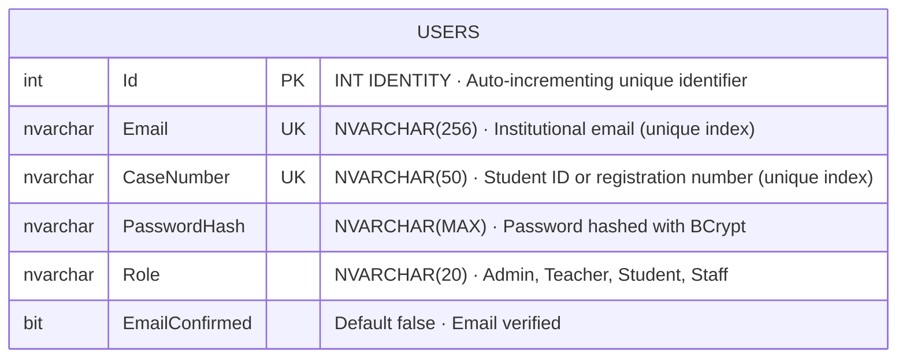
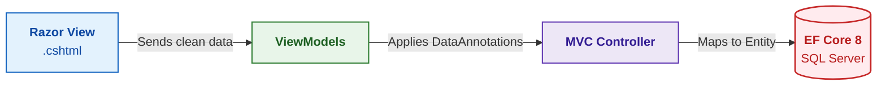

#  VozUniversitaria

### System Architecture

*Web platform for communication, reports, and suggestions for the university community*

---

##  Table of Contents

1. [Introduction and Overview](#1-introduction-and-overview)
2. [Requirements and Quality Attributes](#2-requirements-and-quality-attributes-non-functional-requirements)
3. [Technology Stack](#3-technology-stack)
4. [Structure and Architectural Pattern](#4-structure-and-architectural-pattern)
5. [Main Components and Responsibilities](#5-main-components-and-responsibilities)
6. [Communication and Data Flows](#6-communication-and-data-flows)
7. [Design Decisions (ADRs)](#7-design-decisions-adrs)
8. [Structural Data Model](#8-structural-data-model)

---

## 1. Introduction and Overview

###  Purpose

Develop a comprehensive web platform that acts as the **official channel for communication, reports, and suggestions** between students, faculty, administrative staff, and university authorities, promoting transparency and the efficient resolution of procedures and incidents.

###  Scope of Current Development (Phase 1)

In the current phase, the project focuses on building a **solid foundation of security, access control, and identity management**. The implemented features include:

| Module | Description |
|--------|-------------|
|  **Authentication** | User registration and secure login. |
|  **Security Verification** | Identity validation through institutional email verification. |
|  **Role-Based Access Control (RBAC)** | Differentiated permissions and views for Students, Teachers, Administrators, and Staff. |

---

## 2. Requirements and Quality Attributes (Non-Functional Requirements)

###  Scalability

- **Performance:** .NET 8 can handle a high volume of concurrent users by increasing hardware resources (*vertical scalability*).
- **Infrastructure:** the MVC architecture makes it easier to adopt load balancers and Docker containers in the future (*horizontal scalability*).
- **Database:** queries optimized with EF Core 8 to avoid slowdowns as the number of users in SQL Server grows.

###  Availability

- **Continuity:** availability target of **99.9% uptime**, ensuring the platform is consistently active for the university community.
- **Consistent environments:** use of Dev Containers to reduce configuration errors between development and final deployment.

###  Security

- **Access control:** secure authentication and role-based authorization (RBAC) to segment the functions of Students, Teachers, Administrators, and Staff.
- **Encryption:** passwords protected with hashing through `BCrypt.Net-Next`, and data in transit encrypted over HTTPS.
- **Web protection (production environment):** native mitigation against XSS attacks in Razor views and use of anti-CSRF tokens in forms.
- **Validation:** mandatory account activation through institutional email verification.

###  Maintainability

- **Clean code:** separation of concerns thanks to the MVC pattern, making it easy to add future modules (reports, announcements, etc.) without breaking existing code.
- **Teamwork:** use of GitFlow to develop features in an isolated, organized, and safe way.
- **System evolution:** database version control through EF Core migrations.

---

## 3. Technology Stack

| Layer | Technologies | Justification |
|-------|--------------|---------------|
|  **Frontend** | Razor Views, HTML5, CSS3, JavaScript, Bootstrap 5, jQuery | Razor renders the interface quickly on the server with C#. Bootstrap 5 ensures a responsive design (adapts to mobile phones) and jQuery handles interactivity and form validation without reloading the page. |
|  **Backend** | .NET 8 (C#), ASP.NET Core MVC | MVC cleanly separates the code so future features can be added easily. .NET 8 offers very high performance and native tools to manage roles and block attacks. |
|  **Database and Security** | SQL Server, Entity Framework Core 8, BCrypt.Net-Next | SQL Server securely organizes relational data (users and roles). EF Core 8 allows querying the database using C# (no manual SQL), and BCrypt hashes passwords so they cannot be stolen. |
|  **Infrastructure / DevOps** | VS Code Dev Containers, Git, GitFlow | Dev Containers (Docker) ensure the whole team works with the same software configuration. GitFlow organizes code into independent branches so the team can work without overwriting each other's progress. |

---

## 4. Structure and Architectural Pattern

###  Chosen pattern: Monolithic Model-View-Controller (MVC)

The application adopts a **Modular Monolith** architecture based on the native MVC design pattern of ASP.NET Core. All components (business logic, database, and interface) are unified in a single deployable project.

###  Justification versus other alternatives

- **Development speed versus microservices:** a microservices system would add unnecessary complexity (networking, multiple databases, communication APIs) for the current phase. The monolith allows registration and login to be developed right away.
- **Efficient coupling with Razor:** with Razor Views, the View and the Controller live in the same server ecosystem. This removes the need for a decoupled backend (such as a separate Web API with a React frontend), reducing data transfer time and simplifying deployment.
- **Separation of concerns:** although it is a monolith, MVC clearly divides the code: **Models** manage data through EF Core, **Views** control the interface, and **Controllers** handle the request logic.

###  Architecture Diagram

Flow of data and components within the architecture using .NET 8 and Dev Containers:

---

## 5. Main Components and Responsibilities

###  Authentication and Access Control Module (*Auth Module*)

**Function:** securely manage the lifecycle of user sessions within the platform.

**Responsibility boundaries:**

- Process login and logout.
- Validate the credentials entered by comparing them against the database records.
- Implement the **Role-Based Authorization (RBAC)** mechanism so that, after login, the user is redirected only to the views authorized for their role (*Student, Teacher, Administrator, or Staff*).

####  Users and Roles Diagram (RBAC)

After logging in, each role is redirected only to the views authorized for it.

###  User Management and Verification Module (*User Management*)

**Business logic it encapsulates:**

- **Structured registration:** captures new users' data while ensuring format compliance (such as the mandatory use of institutional email).
- **Preventive hashing:** delegates secure password hashing to `BCrypt.Net-Next` before passwords leave the business logic.
- **Identity verification:** generates a one-time **verification code (OTP)** and manages the user's state (*Inactive / Active*). It sends the code to the institutional email so the user can enter it on the platform and confirm they legitimately belong to the university community.

###  Persistence Layer (*Data Access Layer*)

**Communication with the database:**

- **Entity Framework Core 8** is used as the system's official Object-Relational Mapper (ORM).
- .NET 8 services and controllers **do not write SQL manually**: they run structured queries with **LINQ** in C#, which EF Core automatically translates into efficient statements for SQL Server.
- This layer encapsulates the data schema (table models for Users and Roles) and uses **Migrations** to apply changes in a controlled way and maintain referential integrity.

---

## 6. Communication and Data Flows

###  Protocols

| Protocol | Use |
|----------|-----|
| **HTTPS** | Main and mandatory protocol. All communication between the user's browser (Client) and the .NET 8 server is encrypted with TLS to protect sensitive data such as passwords and emails. |
| **Form POST / AJAX (HTTP)** | Standard synchronous requests (HTML forms using POST) and asynchronous requests with jQuery (AJAX) to update parts of the screen without reloading the page. |
| **SMTP** | External protocol used by the server to connect to the email service and send account verification messages. |

###  Typical Flow: User Registration and Email Verification

The exact path the data follows when a new member of the university community creates an account:

###  Step by step

1. **Data submission:** the user enters their data (name, institutional email, role) and clicks *Register*. The form travels over HTTPS POST, including a security token against CSRF attacks.
2. **Processing and hashing:** the Controller validates the fields and uses `BCrypt.Net-Next` to hash the password. It also generates a one-time verification code (OTP) to validate the email.
3. **Initial persistence:** through Entity Framework Core 8, the system inserts the record into SQL Server with `EmailConfirmed = false`.
4. **Email dispatch:** the backend uses SMTP to automatically send an email to the user's institutional address with the generated verification code.
5. **Account activation:** the user checks their inbox and enters the code on the verification screen. The browser sends a new request to the controller, which looks up the code in the database, validates that it matches, sets the status to `EmailConfirmed = true`, and redirects the user to the login screen.

---

## 7. Design Decisions (ADRs)

<b>ADR-001 · Monolithic Architecture (ASP.NET Core MVC)</b>

| | |
|---|---|
| **Context** | The core of VozUniversitaria (registration, login, and roles) needed to be structured quickly. |
| **Decision** | Adopt a Modular Monolith with Razor Views to render the interface directly on the server. |
| **Consequences** | Faster development, unified native security, and simple deployment, at the cost of short-term flexibility for native mobile apps. |

<b>ADR-002 · Cookie-Based Authentication</b>

| | |
|---|---|
| **Context** | The system must restrict screens according to user type (`Student`, `Teacher`, `Admin`, `Staff`). |
| **Decision** | Implement native Cookie-Based Authentication together with role-based authorization policies (*Role Claims*). |
| **Consequences** | Automatic and secure session control in the browser, without the complexity of configuring and implementing JWT tokens. |

<b>ADR-003 · Unique Constraints in the Database</b>

| | |
|---|---|
| **Context** | Prevent duplicate accounts or fake identities in the university portal. |
| **Decision** | Apply unique indexes in SQL Server through EF Core 8 on the `Email` and `CaseNumber` (student ID) fields. |
| **Consequences** | Absolute data integrity at the server level, requiring exceptions to be handled in C# to show clean messages to the user. |

<b>ADR-004 · Development Containers (Dev Containers)</b>

| | |
|---|---|
| **Context** | The team needed to avoid configuration problems caused by differences in operating systems or .NET versions. |
| **Decision** | Standardize the environment using VS Code Dev Containers with Docker. |
| **Consequences** | One-click ready environment and full parity across the team, requiring local machines to support Docker. |

---

## 8. Structural Data Model

For the current phase, the system works with a relational schema centered on the **`Users`** entity. Persistence is managed in SQL Server through Entity Framework Core 8, applying constraints at the database level and business validations at the interface level through *DataAnnotations*.

###  Main Entity: `Users`

| Field | C# Type | SQL Type | Constraints / Validation | Description |
|-------|---------|----------|--------------------------|-------------|
| `Id` | `int` / `Guid` | `INT IDENTITY` / `UNIQUEIDENTIFIER` |  Primary Key | Unique identifier and primary key of the record. |
| `Email` | `string` | `NVARCHAR(256)` | `Required`, `EmailAddress`, Unique Index | Institutional email address. Duplicates are not allowed. |
| `CaseNumber` | `string` | `NVARCHAR(50)` | `Required`, Unique Index | Unique case number, student ID, or university registration number. |
| `PasswordHash` | `string` | `NVARCHAR(MAX)` | `Required` | Password hashed with the BCrypt algorithm. |
| `Role` | `string` / `enum` | `NVARCHAR(20)` | `Required` | Role for access control (`Student`, `Teacher`, `Admin`, `Staff`). |
| `EmailConfirmed` | `bool` | `BIT` | Default: `false` | Email verification status (activated through an OTP code sent by email). |

###  Relationship Between Models and ViewModels

To avoid exposing database entities directly to the browser, the data flow implements the decoupling pattern through **ViewModels**, located in the `ViewModels/` folder:

**1. `RegisterViewModel`**
- Encapsulates the capture fields: `Email`, `CaseNumber`, `Password`, and `ConfirmPassword`.
- Applies runtime validation rules (for example, checking that both passwords match) before passing the data to the controller.

**2. `LoginViewModel`**
- Reduces the payload to the essential fields: `Email` (or `CaseNumber`) and `Password`.
- Includes the optional session persistence property (`RememberMe`) for managing authentication cookies.

###  Database Schema (SQL Server)

Persistence is managed in SQL Server through Entity Framework Core 8. The current model consists of the `Users` entity with strict integrity constraints:

###  Data Flow and Layers (Decoupling)

To protect the integrity of the database, the system does not expose the `Users` entity directly in the views. Instead, it implements **intermediate ViewModels** in the application layer:

1. **`RegisterViewModel`:** captures `Email`, `CaseNumber`, `Password`, and `ConfirmPassword`. Applies server-side validation before registering.
2. **`LoginViewModel`:** requests only the basic credentials (`Email` and `Password`) to process the authentication cookie.

---

**VozUniversitaria** · System Architecture · Phase 1

